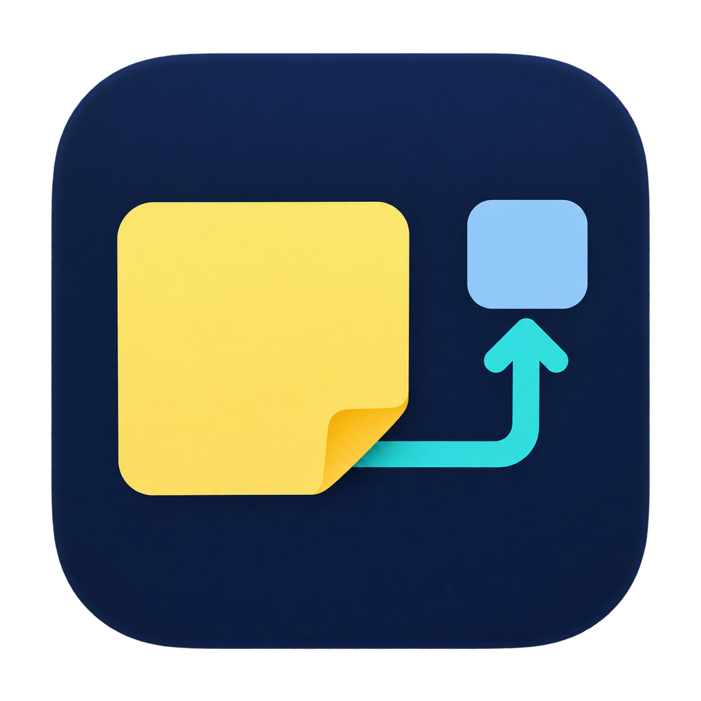

<p align="center"></p>

# nottio

[English（默认）](../README.md) · [日本語](readme-ja.md) · 简体中文

一款面向 Windows 和 macOS 的本地白板，用便签、图形、箭头和图片整理思路。使用 Rust 和 GPUI 开发，操作参考 FigJam。这是原型应用，不提供协同编辑，也不承诺与 FigJam 完全兼容。

## 主要功能

- **便签**：从图形按钮旁的便签按钮拖到画布即可添加；也可以点击按钮或按 N，再点击画布。默认尺寸为180×140。放置后直接输入，按 Escape 结束编辑；拖动移动，双击重新编辑。
- **图形**：矩形、圆角矩形、椭圆、三角形、菱形、星形、六边形；支持线条、箭头和自由绘制。
- **连接**：按 A 选择箭头工具，从一个便签或图形拖到另一个即可连接。连接端点吸附到对象，并随对象移动。支持直线、直角折线和曲线。
- **折点与绕行**：拖动线段中间的控制点调整折线。起点和终点的箭头可分别开启或关闭。自动绕行会避开便签和图形，但不会避开其他连线。
- **框架**：点击便签旁的框架按钮，或按 Shift+S。与框架重叠的内容会一起移动。调整框架大小不会缩放内部内容，不支持嵌套框架。
- **图片**：在画布上按 Ctrl+V（Mac 为 ⌘V）粘贴。图片嵌入 JSON，重新打开或另存副本后仍然保留。编辑文字时只粘贴文字；粘贴图片前请先按 Escape。
- 自动保存、保存副本、打开白板、撤销与重做、浅色与深色主题、记住工具栏位置。

## 运行

```sh
git clone https://github.com/eiei114/nottio.git
cd nottio
cargo run
cargo build --release
```

**Windows**：需要 stable Rust、MSVC 目标、Visual Studio Build Tools 的“使用 C++ 的桌面开发”组件及 Windows SDK。

**macOS**：需要 macOS 14 Sonoma 或更新版本、Apple Silicon 或 Intel Mac、stable Rust 和 Apple Command Line Tools（`xcode-select --install`）。请使用与本机 CPU 对应的 Rust 目标。Metal 着色器在启动时编译，无需单独安装 Metal 编译器。

生成带 Finder / Dock 图标的应用包，需要 Python 3.11 或更新版本，不需要 Pillow：

```sh
python3 scripts/build-macos-app.py
open target/macos/nottio.app
```

此 `.app` 使用本地临时签名（ad-hoc），不是经过 Developer ID 签名和 Apple 公证的发行版，也不是 DMG 安装包。Apple Silicon 和 Intel 需分别构建，不生成通用二进制文件。

## 快捷键

Windows 使用 Ctrl，Mac 使用 ⌘：复制/剪切/粘贴为 C/X/V，撤销为 Z，重做为 Shift+Z。打开白板：Ctrl+O / ⌘O；保存副本：Ctrl+Shift+S / ⌘⇧S。Mac 的 ⌘Q 会先保存再退出。临时取消端点吸附以及鼠标平移手势，在 Mac 上仍使用 Control。

工具：V＝选择，H＝平移，N＝便签，R＝矩形，O＝椭圆，G＝三角形，A＝箭头，X / Shift+L＝折线，T＝文字，Shift+S＝框架。

## 数据与限制

| 系统 | 工作数据 |
| --- | --- |
| Windows | `%APPDATA%\nottio\board.json` 和 `ui-state.json` |
| macOS | `~/Library/Application Support/nottio/board.json` 和 `ui-state.json` |

可通过 `NOTTIO_DATA_DIR` 指定其他目录。工作白板会不断覆盖为最新状态；需要保留某一版本时，请使用“File → Save a copy…”保存副本。单张图片限制为32 MiB、每边8192像素、总计1600万像素。不支持 SVG、动画或粘贴图片文件路径。

CI 执行 Windows 和 Mac 的原生构建与测试。日文/中文输入法、辅助功能、触控板及最低支持版本上的实际界面操作，仍需在实体 Mac 上验证。

## 开发与许可证

```sh
cargo test --locked --workspace
cargo clippy --locked --workspace --all-targets -- -D warnings
python3 scripts/test-icon-assets.py   # 需要 Pillow
python3 scripts/test-macos-bundle.py
```

[英文详细说明](../README.md) / [Mac 验证清单](macos-support.md) / [实现与验证记录](verification.md)。保留第三方[白板库](../vendor/gpui-whiteboard/LICENSE)、[图标](../vendor/gpui-whiteboard/assets/icons/LICENSE)和[字体](../vendor/gpui-whiteboard/assets/JetBrainsMono-OFL.txt)的许可证。

文档提供多种语言，不代表应用界面已完成多语言本地化。
