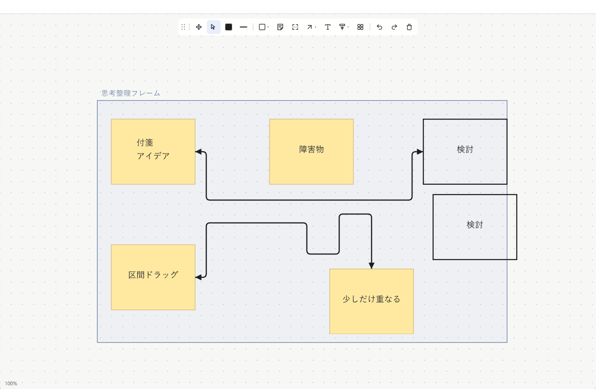
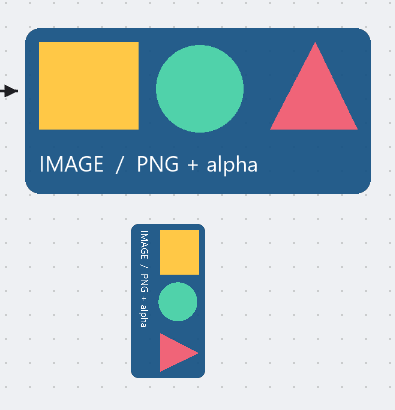

# Sticky, connector, section and clipboard-image verification

Commands run on Windows against this workspace:

```sh
cargo fmt --all -- --check
cargo test --workspace
cargo clippy --workspace --all-targets -- -D warnings
cargo build --release --bin nottio
```

The suite has 92 passing tests (76 library + 16 host). Ten GPUI input-tree
integration tests cover native-toolbar sticky drag creation, Japanese multiline
text, note movement, creation cancellation, genuine snapped note-to-shape
arrows, elbow dragging, independent arrowhead toggles, straightening, cancelling
a bend, endpoint following on note movement, undo/redo and JSON restore. Automatic
detours are tested around an intervening note, including recomputation when it
moves, restoring the detour with undo, toggling routing, and saving only the
preference rather than derived coordinates. Pure routing tests cover clearance,
unobstructed straight paths and bounded capacity.

The fifth input-tree test starts with the actual Arrow shortcut and drags from
one note body to another. It checks facing-side attachments, switches to a curve,
drags its on-path handle, reconnects an endpoint onto another object body, undoes
and redoes that reconnection, then switches through straight/bent modes and checks
JSON restore. A pure geometry test checks distinct paths, rounded bent corners,
curve handle placement and serialization.

Portion editing is tested through the actual rendered handles: a one-portion
connector grows terminal folds, an interior portion moves on one axis, the end
portion adds more folds, Escape restores the whole path, undo/redo restore the
gesture, and alignment collapses redundant vertices. A no-op handle click creates
no undo entry. The removed add/remove-fold buttons are asserted absent. Pure
tests cover sharp path editing, compact JSON, legacy waypoint documents, endpoint
following, capacity, transforms and coincident endpoints.

The shortcut test checks X, Shift+L, L, V/Escape, Ctrl snapping bypass and Shift+S.
Frame integration tests create a frame over existing objects, rename its header,
move notes/triangles/attached arrows/crossing lines together, include a one-unit
overlap, do not scoop up unrelated objects mid-drag, undo/redo, cancel, save/restore,
let a member leave, and preserve a connector to that outside member. A separate
test covers default-square creation on click and Enter finishing frame rename.
Pure tests cover actual line intersection, overlap exit and nonduplicated ownership.

The actual diagonal connector from the user's saved scene is a regression fixture.
Tests check canonical horizontal/vertical legs, unchanged endpoints, persisted
repair, no direct Bent rotation, and normalization after a group rotation.

The host input-tree test wires the real application clipboard/image hooks, writes
a bitmap to GPUI's **test-platform** clipboard, then dispatches Ctrl+V through the
rendered board. It checks the selected object's initial 280 × 140 geometry,
movement, nonuniform edge resize, undoing movement/resizing/creation, redo,
Ctrl+C/Ctrl+V with identical embedded pixels, disk save/reopen, source rendering,
JSON priority over an invalid bitmap, and rejection without scene changes.
Image unit tests check PNG transparency, quarter-turn cache reuse, BMP/JPEG
normalization, invalid bytes, encoded-size limits, and refusal of URL/file sources.
A frame test checks partial image overlap, exactly-once movement and full exit.
These checks do not overwrite the user's real Windows clipboard.

Native Windows render smoke: a separate `NOTTIO_DATA_DIR` fixture displayed
Japanese sticky text, rectangles, an orthogonal connector detouring around an
intervening note with rounded corners, and a curved connector. Both had heads
at both ends. The selected connector's toolbar and circular handle also rendered.
Window close saved all seven fixture objects before the process exited. The
fixture did not overwrite or delete the working board.


Historical smoke, before direct portion editing: a second isolated fixture
displayed three independent manual handles,
multiple rounded folds and the **＋ 折り目 / − 折り目** toolbar actions. Closing it
saved the two additional handles as JSON, retaining both endpoint bindings.


The add/remove-fold buttons in that historical screenshot have since been
replaced by direct portion handles. Current native render-only smoke shows a
section title/background, selected bent path and a repaired connector from the
user's saved scene. All sharp legs are horizontal/vertical. It preserves the
active nine-object fixture and the separate eight-object standard board.



One physical mouse-injection attempt did not satisfy the intended exact-coordinate
movement assertion. Native movement is **not** claimed from that attempt; the
deterministic input-tree tests above provide movement evidence instead. Clipboard
Ctrl+V is verified by the host test, not claimed as a physical Windows input smoke.

The image release also opened a five-object isolated fixture from disk. Native
Windows rendering displayed its embedded transparent PNG and the same bitmap at
a 90° rotation. Closing retained all five objects. The normal active nine-object
board was then reopened with its saved camera; the separate standard eight-object
board remained unchanged. This cropped artifact contains only generated fixtures:



The deterministic interaction tests use GPUI's test platform. They do not
certify physical mouse automation, every IME composition flow, accessibility,
stress performance, collaboration or full production readiness.

## Generated Windows application icon

`python scripts/generate-icon.py` validates the ICO directory and all ten image
resolutions (16, 20, 24, 32, 40, 48, 64, 96, 128 and 256px). Small-size previews
were visually checked. The full 92-test suite, Clippy with warnings denied,
format checks and optimized Windows build passed with the icon resource linked.

`powershell -File scripts/verify-app-icon.ps1 -AppPid <running-pid>` verified
RT_GROUP_ICON **#1**, its ten resolutions, both shell-extracted icon sizes and
the running GPUI window class's non-null application HICON. The extracted shell
icon visibly matches the generated yellow note / turquoise arrow artwork.
This uses read-only Win32 inspection, not Explorer cache manipulation or runtime
icon injection. The app restarted using the same data directory; the active
nine-object board and separate standard eight-object board were byte-identical
to their saved backups after restart.

### Pre-existing taskbar pin

The subsequent taskbar request exposed a separate shortcut setting: the pin
targeted the correct executable but its IconLocation was `,0` (empty filename).
The resource/window-class check above still passed. A read-only shortcut check
reported `configured: false`; applying `scripts/set-taskbar-icon.ps1` backed up
the link, set the generated ICO explicitly and issued SHCNE_UPDATEITEM for that
link only. Repeated Apply/read-only checks report `configured: true`, verifying
unchanged target, arguments and working directory. A native taskbar capture
visually confirmed the yellow-note/turquoise-arrow icon. No app restart, global
cache purge, pin removal or app-grouping change was needed. Rust runtime code and
board storage were untouched, so the preceding 92-test/build results still apply.
