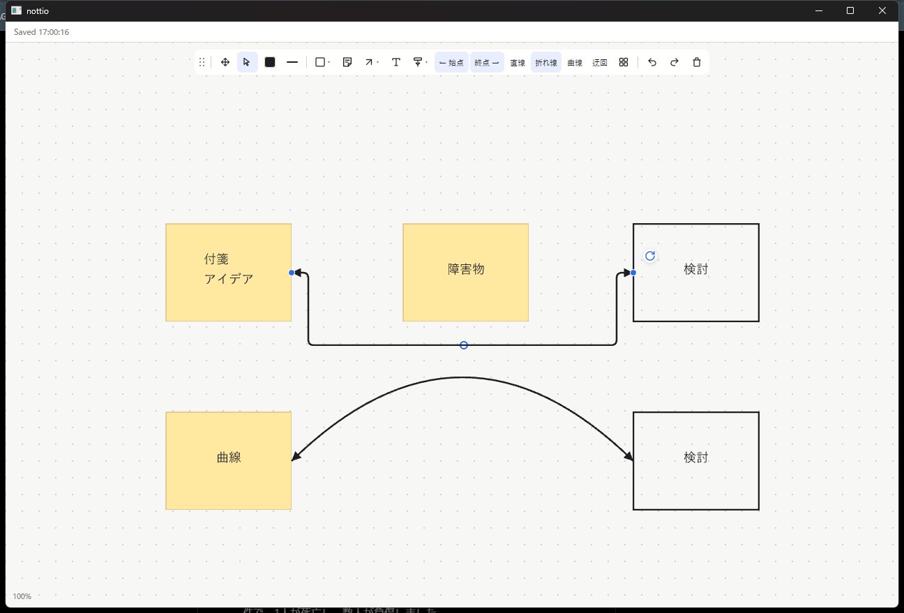
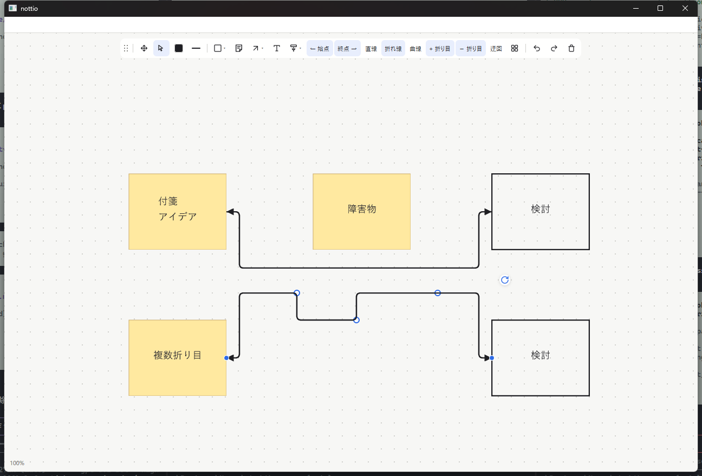

# Sticky and connector verification

Commands run on Windows against this workspace:

```sh
cargo fmt --all -- --check
cargo test --workspace
cargo clippy --workspace --all-targets -- -D warnings
cargo build --release --bin nottio
```

The suite has 74 passing tests (62 library + 12 host). Six GPUI input-tree
integration tests cover native-toolbar sticky drag creation, Japanese multiline
text, note movement, creation cancellation, genuine snapped note-to-shape
arrows, elbow dragging, independent arrowhead toggles, straightening, cancelling
a bend, endpoint following on note movement, undo/redo and JSON restore. Automatic
detours are tested around an intervening note, including recomputation when it
moves, restoring the detour with undo, toggling routing, and saving only the
preference rather than derived coordinates. Pure routing tests cover clearance,
unobstructed straight paths and bounded capacity.

The fifth input-tree test starts with the actual Arrow shortcut and drags from
one note body to another. It checks facing-side attachments, switches to a curve,
drags its on-path handle, reconnects an endpoint onto another object body, undoes
and redoes that reconnection, then switches through straight/bent modes and checks
JSON restore. A pure geometry test checks distinct paths, rounded bent corners,
curve handle placement and serialization.

The sixth input-tree test adds multiple folds from the toolbar, drags an
individual additional handle, checks that other handles/attachments/heads remain
unchanged, cancels another drag, double-clicks to remove a specific fold, undoes
and redoes that removal, removes the last fold with the toolbar and returns to
automatic routing. Compact JSON persistence and capacity-bounded transform
behavior for multiple handles also have a pure regression test.

Native Windows render smoke: a separate `NOTTIO_DATA_DIR` fixture displayed
Japanese sticky text, rectangles, an orthogonal connector detouring around an
intervening note with rounded corners, and a curved connector. Both had heads
at both ends. The selected connector's toolbar and circular handle also rendered.
Window close saved all seven fixture objects before the process exited. The
fixture did not overwrite or delete the working board.



A second isolated native fixture displayed three independent manual handles,
multiple rounded folds and the **＋ 折り目 / − 折り目** toolbar actions. Closing it
saved the two additional handles as JSON, retaining both endpoint bindings.



The deterministic interaction tests use GPUI's test platform. They do not
certify physical mouse automation, every IME composition flow, accessibility,
stress performance, collaboration or full production readiness.
